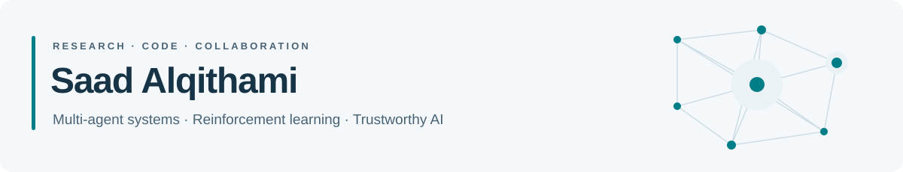

<picture>
  <source media="(max-width: 600px) and (prefers-color-scheme: dark)" srcset="assets/profile-header-dark-mobile.svg">
  <source media="(max-width: 600px)" srcset="assets/profile-header-light-mobile.svg">
  <source media="(prefers-color-scheme: dark)" srcset="assets/profile-header-dark.svg">
  <source media="(prefers-color-scheme: light)" srcset="assets/profile-header-light.svg">
  
</picture>

**Professor of Computer Science**

I study how intelligent agents learn, coordinate, and make accountable decisions in complex environments. My work connects multi-agent systems, reinforcement learning, and networked organizations with applications in logistics, robotics, and cyber-physical systems.

[Website](https://alqithami.github.io/) · [CHMARL](https://chmarl.com/) · [Email](mailto:alqithami@gmail.com)

## Research focus

**Learning and coordination** — Multi-agent reinforcement learning, constrained control, and digital twins.  
**Decision-making foundations** — Perspective-aware cognition, networked organizations, and resource allocation.  
**Trustworthy AI** — Accountability, runtime safeguards, fairness, and cyber resilience.

## Selected research and code

Research frameworks and experiment pipelines, with direct links to code and publications.

<table>
<tr>
<td width="50%" valign="top">
<h3><a href="https://github.com/alqithami/EcoFairCHAMRL">EcoFair-CH-MARL</a></h3>

<strong>Sustainable multi-agent coordination</strong>

Hierarchical reinforcement learning for maritime logistics, combining emissions budgets with fairness-aware resource allocation.

<a href="https://github.com/alqithami/EcoFairCHAMRL">Code</a> · <a href="https://doi.org/10.3233/FAIA251248">ECAI 2025 paper</a>

</td>
<td width="50%" valign="top">
<h3><a href="https://github.com/alqithami/LiA">LIA</a></h3>

<strong>Latency-aware resource allocation</strong>

An auction mechanism and experiment pipeline for resource allocation across heterogeneous-delay communication networks.

<a href="https://github.com/alqithami/LiA">Code</a> · <a href="https://doi.org/10.1007/s11235-026-01465-5">Telecommunication Systems · 2026</a>

</td>
</tr>
<tr>
<td width="50%" valign="top">
<h3><a href="https://github.com/alqithami/AgentTwin">AgentTwin</a></h3>

<strong>Learning-based industrial control</strong>

A multi-agent digital-twin testbed for scheduling and residual control of the Tennessee Eastman Process, with a solver-backed safety shield.

<a href="https://github.com/alqithami/AgentTwin">Code</a> · <a href="https://doi.org/10.1016/j.jprocont.2026.103735">Journal of Process Control · 2026</a>

</td>
<td width="50%" valign="top">
<h3><a href="https://github.com/alqithami/OSL">Observer–Situation Lattice</a></h3>

<strong>Perspective-aware cognition</strong>

A formal framework for representing, propagating, and reconciling agents’ beliefs across different observers and situations.

<a href="https://github.com/alqithami/OSL">Code</a> · <a href="https://doi.org/10.65109/CHZG9392">AAMAS 2026 paper</a>

</td>
</tr>
<tr>
<td width="50%" valign="top">
<h3><a href="https://github.com/alqithami/DC-ADA">DC-Ada</a></h3>

<strong>Adaptation for heterogeneous robots</strong>

Reward-only sensor adaptation for robot teams: adapt compact observation transforms while keeping the shared policy frozen.

<a href="https://github.com/alqithami/DC-ADA">Code</a> · <a href="https://ieeexplore.ieee.org/document/11493968">IEEE Access paper</a>

</td>
<td width="50%" valign="top">
<h3><a href="https://github.com/alqithami/vchimera">V-CHIMERA</a></h3>

<strong>Cyber resilience and communication</strong>

With Fahad Alghamdi: a framework coupling cyber-incident response and verified communication under misinformation.

<a href="https://github.com/alqithami/vchimera">Code</a> · <a href="https://doi.org/10.3390/biomimetics11050324">Biomimetics · 2026</a>

</td>
</tr>
</table>

[Explore all public repositories →](https://github.com/alqithami?tab=repositories&type=source)

## CHMARL · From research to application

I lead **CHMARL**, an applied AI project developing decision support for port and logistics coordination. The work connects multi-agent reinforcement learning with operational constraints, sustainability, and fair resource allocation.

[Project website](https://chmarl.com/) · [Original CH-MARL framework](https://github.com/alqithami/CH-MARL) · [EcoFair research code](https://github.com/alqithami/EcoFairCHAMRL)

## Collaboration

I welcome research and industry collaboration on multi-agent learning, trustworthy decision systems, and applied AI.

**Contact:** [alqithami@gmail.com](mailto:alqithami@gmail.com)

For experiment setup, scope, and citation details, consult each repository’s README. Archived repositories preserve fixed research artifacts.
